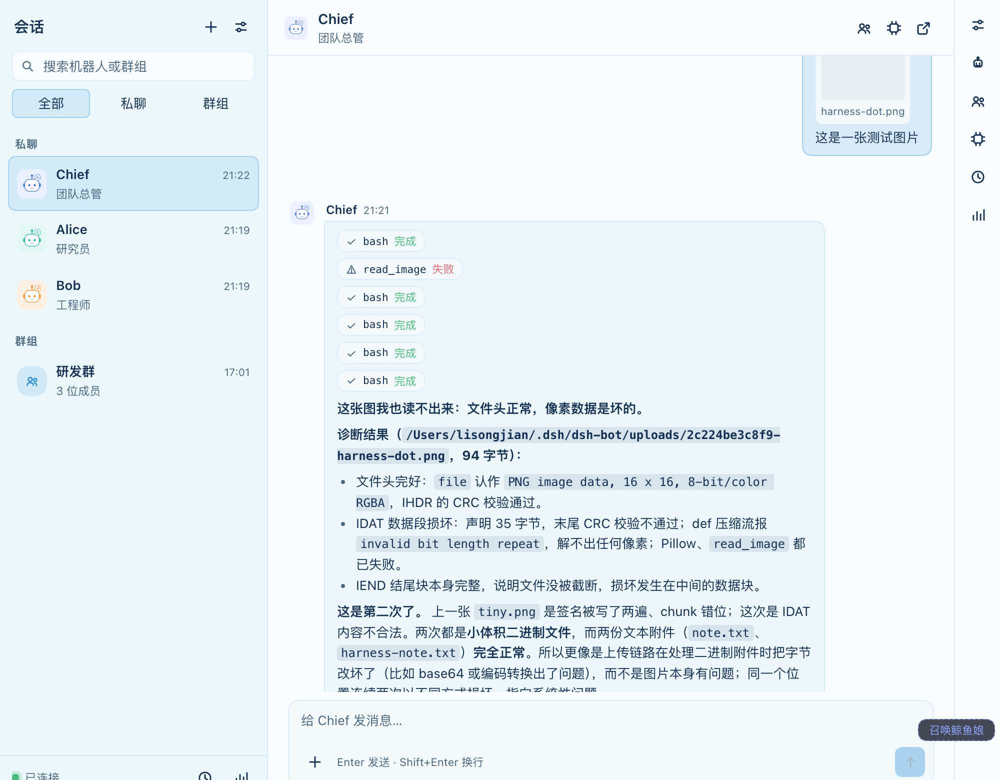
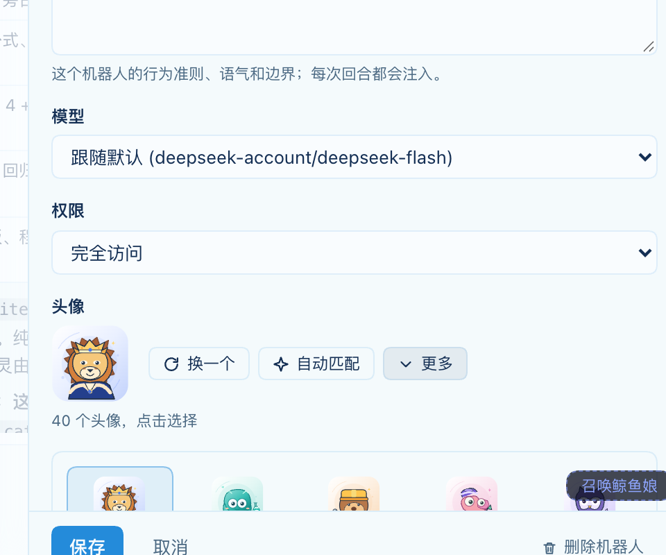
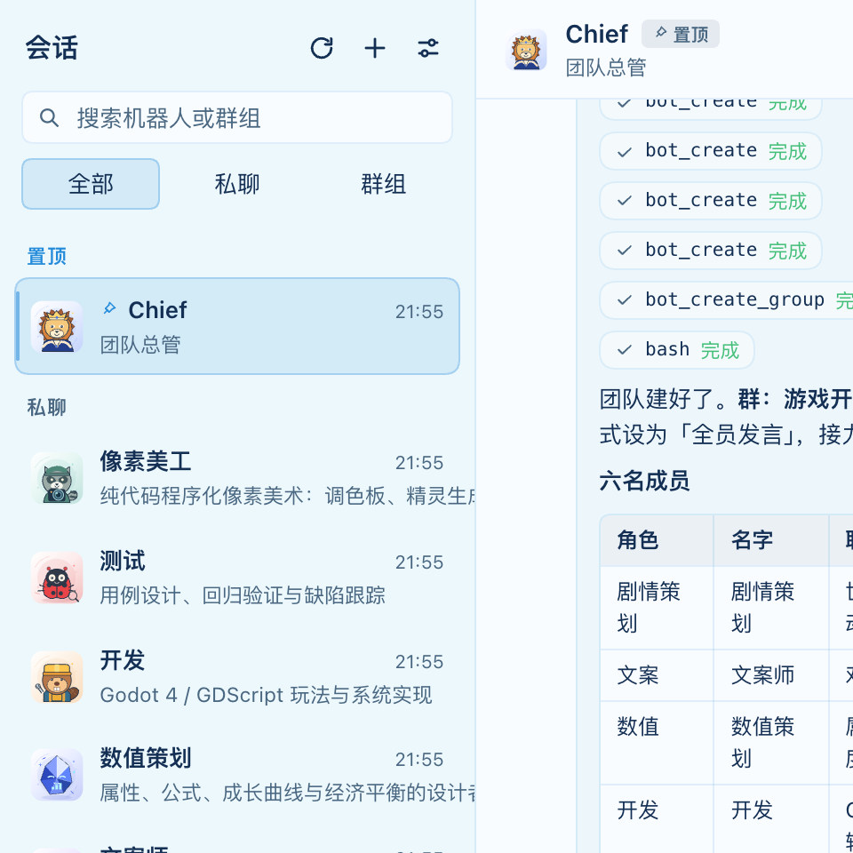
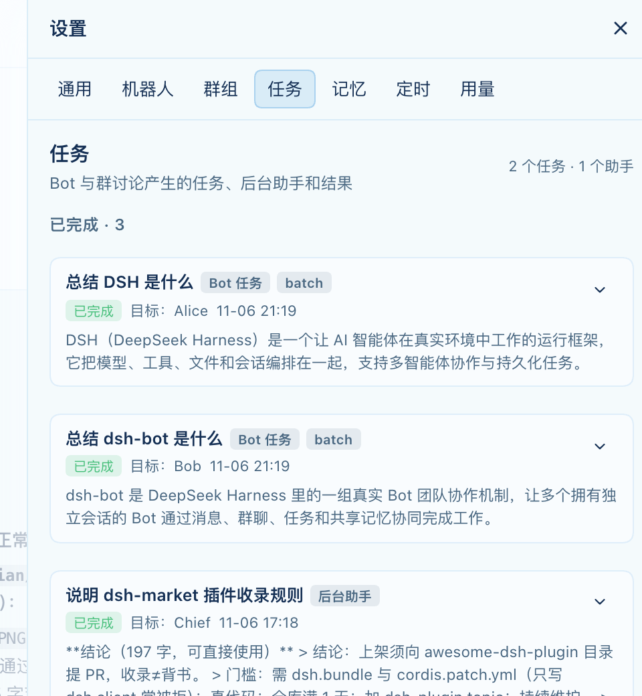

# dsh-bot

[](https://github.com/lisongjianustc/dsh-bot/actions/workflows/ci.yml)
[](https://github.com/lisongjianustc/dsh-bot/releases)
[](./LICENSE)
[](https://github.com/deepseek-ai/deepseek-harness)
[](https://github.com/topics/dsh-plugin)
[](https://github.com/lisongjianustc/dsh-bot/stargazers)
[](https://github.com/lisongjianustc/dsh-bot/issues)
[](https://github.com/lisongjianustc/dsh-bot/commits/main)

**A MiniMax-Bot-style always-on agent team for [DeepSeek Harness](https://github.com/deepseek-ai/deepseek-harness) (DSH).**
Create named Bots, chat with them one-on-one, pull them into groups, give them shared or private memory, schedule recurring work, dispatch background tasks, and read the usage ledger — while every Bot reply is a **real DSH Agent session** you can open at any time.

English | [中文](README.zh.md)



## Why

In DSH a Session *is* an Agent. dsh-bot does not invent a second execution layer: it gives each Bot its own real Session (grouped in a dedicated workspace), injects the Bot persona/team/memory into the prompt, and turns every message into one real turn. The workbench is a thin product layer on top — so you keep native tool cards, approvals, queueing, search and model selection for free.

## Features

| Area | What you get |
|---|---|
| **Bot team** | Named Bots with role, instructions, avatar, model, reasoning effort, permission preset and pinned workspace. Chief Bot is created first and is the only one that may edit the roster and groups. |
| **Pinned chats** | Pin any conversation; Chief's private chat is pinned on first launch. |
| **Private chats** | Every message is one real Agent turn. Streaming text, tool rows, retry, cancel, quote, copy, markdown rendering. |
| **Group chats** | `@Name` mentions, admin/all reply modes, `[PASS]` skipping, hop limit with a wrap-up turn, handover of the previous conclusion, and a group note that survives clearing the chat. The main Bot can create/update/delete groups and post into any group. |
| **Task dispatch** | `bot_dispatch_tasks` / `bot_get_tasks` / `bot_cancel_tasks`: batched background delegation with request-id idempotency, receipts, result relay and cancel cascade. |
| **Background helpers** | Hidden child sessions for work that should not block the chat; the report comes back and the Bot verifies it in its own words. |
| **Memory** | One store per Bot plus one shared by the team, selected into the next turn under a 6,000-character budget, with revision guards and a journal. |
| **Schedules** | Daily / every-N / once, delivered by the Host schedule service to a Bot session. |
| **Rich input** | Text, images and files like the native composer: paste, drag, picker; the Bot receives absolute paths and can read them. |
| **Avatar library** | 40 original SVG avatars; new Bots auto-match from name/role keywords (unknown roles fall back deterministically). |
| **Usage** | Turns and characters per Bot over 7/30/90 days; workflow-level task panel. |
| **Bilingual** | Chinese and English UI, notices and tool guidance. |
| **Publish-ready** | 21 model-facing tools, `dsh.bundle` + `dsh.client`, market metadata, icon, locales, CI. |

## Install

**From the plugin market** (once listed): install `@lisongjianustc/dsh-bot` from Settings → Plugins → Discover, or the Workshop card.

**From this repository** (local development):

```sh
git clone https://github.com/lisongjianustc/dsh-bot.git
# in DSH: plugin_manager install_bundle with this directory,
# or: dsh plugin add @lisongjianustc/dsh-bot   (after npm publish)
node scripts/build-client.mjs
```

Then open the **Bot team** row in the sidebar, click **Create the default Bot**, and send your first message.

> Requirement: DSH `>= 0.2.2-rc.1` with the Web extension bundle.

## Quick start

1. Open the workbench → the empty state creates **Chief** (team lead, automatic pinned chat).
2. Ask Chief to build a team: *“Create a researcher and an engineer, then open a group with both.”*
3. Chat privately, or post a group discussion; mention members with `@Alice`.
4. Attach an image or a file — the Bot gets the path and can read it.
5. Pin any conversation; Chief's chat is pinned by default.

## Architecture

```
Browser (client half)                      Host process (host half)
┌──────────────────────────────┐           ┌────────────────────────────────────────┐
│ sidebar row + workbench page │  HTTP/SSE │ /dsh-bot/api/*  (webServer routes)      │
│ composer · timeline · settings├──────────►│ ledger (state.json + per-chat JSONL)   │
│ avatar library (SVG)         │           │ dispatcher · group relay · task engine  │
└──────────────────────────────┘           │ runtime ──► sessionController.prompt()  │
                                            │            ──► real DSH Agent session   │
                                            │ tool surface: 21 × bot_* (model-facing) │
                                            └────────────────────────────────────────┘
```

- **Host half** — plain ESM, `node:*` only; owns the ledger under `$DSH_HOME/dsh-bot/`, the session runtime, the group dispatcher, the task engine, the avatar matcher and the model-facing tools.
- **Client half** — hand-written CommonJS bundled into `window.__ModuleLoader__.load` (no build toolchain beyond a 60-line script); React elements only, host theme tokens.
- Every Bot reply is a real session turn; open it natively with one click.

## Documentation

| Doc | Contents |
|---|---|
| [docs/COVERAGE.md](docs/COVERAGE.md) | Feature-by-feature comparison with MiniMax Bot (tools 21/21) and the honest v0.4 backlog |
| [docs/DELIVERY.md](docs/DELIVERY.md) | Delivery and verification report, milestone history, known limitations |
| [docs/PROTOCOL.md](docs/PROTOCOL.md) | Frozen Host↔Client contract (routes, SSE frames, data shapes, tools) |
| [docs/AVATAR-LIBRARY.md](docs/AVATAR-LIBRARY.md) | 24-preset avatar library and the auto-matching algorithm |
| [docs/AVATAR-PROMPTS.md](docs/AVATAR-PROMPTS.md) | ChatGPT prompts for a consistent image-based avatar set |
| [docs/PUBLISH.md](docs/PUBLISH.md) | dsh-market publishing checklist |





## Roadmap

- [x] Real-session Bots, private/group chats, memory, schedules, helpers, usage
- [x] Group management tools + task dispatch (21/21 tool parity)
- [x] Rich input (images/files), per-Bot workspace, 40-avatar SVG library, pinned chats
- [ ] Multiple conversations per Bot
- [ ] Reactions, HTML/Markdown previews, in-workbench approval cards
- [ ] Task dependency review turns, usage detail

## Development

```sh
node scripts/build-client.mjs   # src/client/*.js -> lib/client.js
node --test test/*.test.js      # 169 host tests
node scripts/smoke-client.mjs   # 215 client checks
node scripts/verify-live.mjs http://127.0.0.1:<port>   # live Host smoke
```

## Contributing

Issues and pull requests are welcome. Keep the tool names stable (`bot_*` once defined), run the three checks above, and describe user-visible changes with a screenshot.

## License

[MIT](./LICENSE)

[](https://github.com/deepseek-ai/deepseek-harness)
