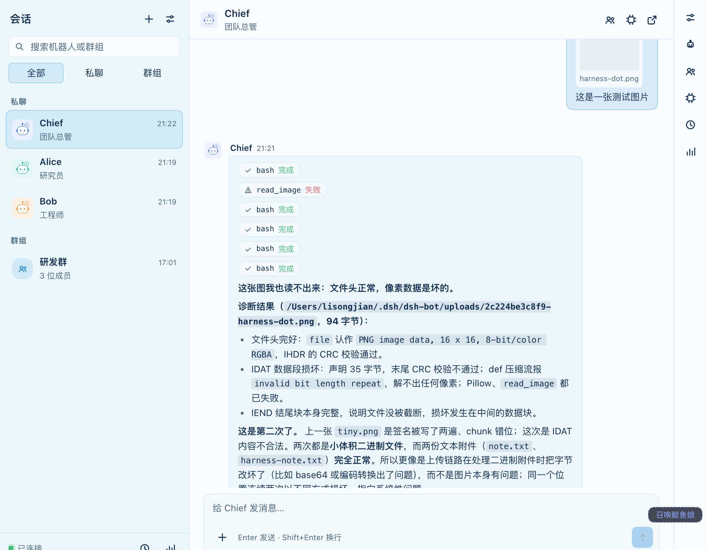
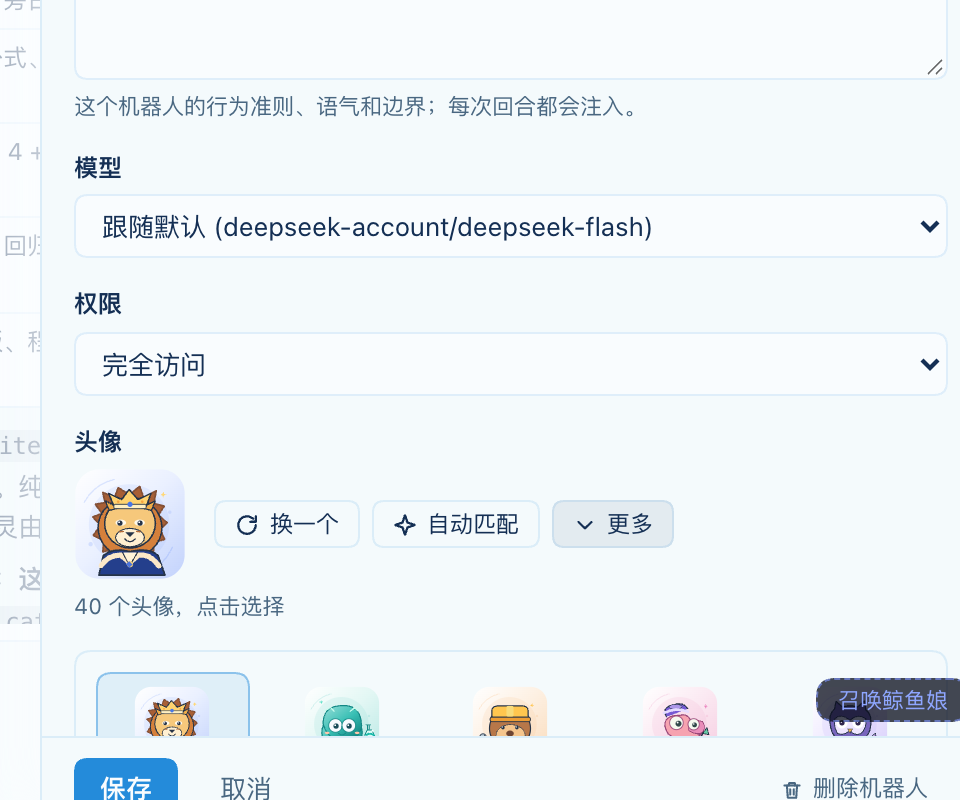
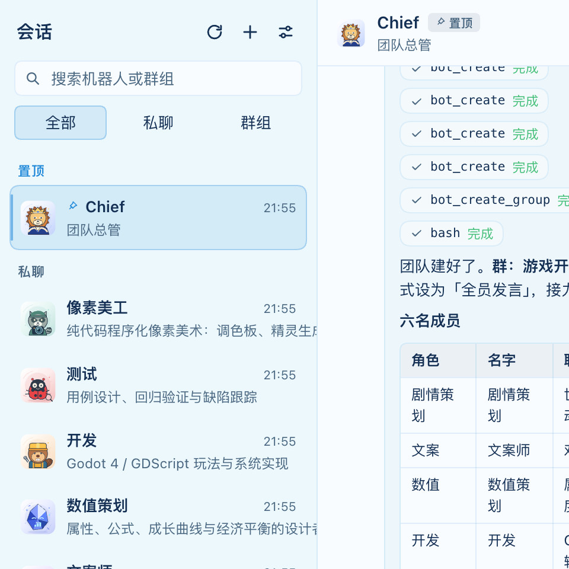
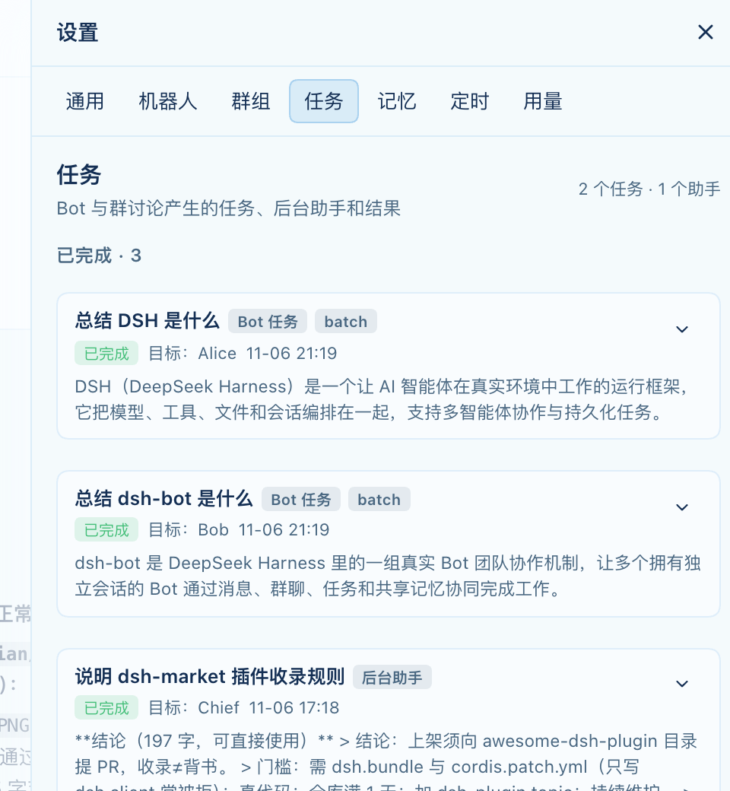

# dsh-bot

[](https://github.com/lisongjianustc/dsh-bot/actions/workflows/ci.yml)
[](https://github.com/lisongjianustc/dsh-bot/releases)
[](./LICENSE)
[](https://github.com/deepseek-ai/deepseek-harness)
[](https://github.com/topics/dsh-plugin)
[](https://github.com/lisongjianustc/dsh-bot/stargazers)
[](https://github.com/lisongjianustc/dsh-bot/issues)
[](https://github.com/lisongjianustc/dsh-bot/commits/main)

**[DeepSeek Harness（DSH）](https://github.com/deepseek-ai/deepseek-harness) 的 MiniMax Bot 式常驻机器人团队。**
创建有名字的 Bot、和它们私聊、拉群协作；给它们团队共享或私有记忆；设定时任务；派发后台任务；查看用量账本。**每条 Bot 回复都是一次真实的 DSH Agent 会话**，随时可以点开原生聊天查看工具调用与审批。

[English](README.md) | 中文



## 为什么

在 DSH 里，**一个 Session 就是一个 Agent**。dsh-bot 不另造执行层：每个 Bot 拥有自己的真实会话（统一挂在专用 workspace），插件把 Bot 人格/团队/记忆注入提示词，把每条消息变成一次真实回合。工作台只是一层产品外壳——工具卡、审批、队列、搜索、模型选择全部原生继承。

## 功能

| 模块 | 说明 |
|---|---|
| **机器人团队** | 名字/角色/instructions/头像/模型/思考档位/权限档位/固定工作区；初启创建 Chief，只有主 Bot 能改团队与群。 |
| **会话置顶** | 任意会话可置顶（含群聊）；Chief 的私聊首次启动即置顶。 |
| **私聊** | 每条消息=一次真实 Agent 回合；流式文本、工具行、重试、取消、引用、复制、Markdown。 |
| **群聊** | `@名字` 指定成员、admin/all 回复模式、`[PASS]` 跳过、接力跳数上限+收敛回合、handover、跨清空的群备注；主 Bot 可建/改/删群并向任意群发言。 |
| **任务派单** | `bot_dispatch_tasks` / `bot_get_tasks` / `bot_cancel_tasks`：批量后台派单、request_id 幂等、回执、结果回投、取消级联。 |
| **后台助手** | 隐藏子会话执行不阻塞聊天；结果回投后 Bot 用自己的话验收。 |
| **记忆** | 每 Bot 一份 + 团队共享一份；每 turn 6000 字预算、revision 校验、journal。 |
| **定时任务** | 每日 / 每 N 分钟 / 一次性，由 Host schedule 服务投递到 Bot 会话。 |
| **富输入** | 文字、图片、文件（粘贴/拖拽/选择）；Bot 收到绝对路径并可直接读取。 |
| **头像库** | 40 个原创 SVG 头像；新 Bot 按名字/角色关键词自动匹配，未知角色哈希稳定兜底。 |
| **用量与任务面板** | 7/30/90 天用量；batch 任务与后台助手统一在「任务」tab 查看。 |
| **中英双语 · 市场就绪** | 21 个模型工具、`dsh.bundle`+`dsh.client`、图标/locale/CI 齐全。 |

## 安装

**插件市场**（收录后）：设置 → 插件 → 发现，或 Workshop 卡片安装 `@lisongjianustc/dsh-bot`。

**从仓库安装**（本地开发）：

```sh
git clone https://github.com/lisongjianustc/dsh-bot.git
# 在 DSH 中用 plugin_manager install_bundle 指向该目录，
# 或 npm 发布后：dsh plugin add @lisongjianustc/dsh-bot
node scripts/build-client.mjs
```

然后在侧栏点开「机器人」→ 空态「一键创建默认 Bot」→ 发第一条消息。

> 要求：DSH `>= 0.2.2-rc.1`，并加载 Web 扩展 bundle。

## 快速上手

1. 工作台空态创建 **Chief**（团队总管，默认置顶会话）；
2. 对 Chief 说："建一个研究员和一个工程师，再拉一个群"；
3. 私聊或群聊讨论，`@Alice` 指定发言；
4. 拖入图片/文件，Bot 拿到路径即可读取；
5. 任意会话可置顶，Chief 默认置顶。

## 架构

```
浏览器（Client 半）                         Host 进程（Host 半）
┌──────────────────────────────┐           ┌────────────────────────────────────────┐
│ 侧栏入口 + 工作台页面        │  HTTP/SSE │ /dsh-bot/api/*（webServer 路由）        │
│ 输入框 · 时间线 · 设置抽屉   ├──────────►│ 账本（state.json + 每 chat JSONL）      │
│ 头像库（SVG 渲染）           │           │ 调度器 · 群接力 · 任务引擎 · 头像匹配   │
└──────────────────────────────┘           │ runtime ──► sessionController.prompt()  │
                                            │            ──► 真实 DSH Agent 会话      │
                                            │ 21 个模型侧工具（bot_*）                │
                                            └────────────────────────────────────────┘
```

- **Host 半**：纯 ESM、只 import `node:*`；拥有 `$DSH_HOME/dsh-bot/` 账本、会话运行时、群调度、任务引擎、头像匹配、模型工具。
- **Client 半**：手写 CommonJS，经 60 行脚本打包成 `window.__ModuleLoader__.load`；只用 React 元素与宿主主题 token。
- 每条 Bot 回复都是真实会话回合，一键可打开原生会话。

## 文档

| 文档 | 内容 |
|---|---|
| [docs/COVERAGE.md](docs/COVERAGE.md) | 与 MiniMax Bot 的逐项对照（工具 21/21）与 v0.4 backlog |
| [docs/DELIVERY.md](docs/DELIVERY.md) | 交付/验收报告、里程碑、已知限制 |
| [docs/PROTOCOL.md](docs/PROTOCOL.md) | Host↔Client 冻结契约（路由/SSE/数据形状/工具） |
| [docs/AVATAR-LIBRARY.md](docs/AVATAR-LIBRARY.md) | 24 预设头像库与自动匹配算法 |
| [docs/AVATAR-PROMPTS.md](docs/AVATAR-PROMPTS.md) | ChatGPT 图片头像提示词 |
| [docs/PUBLISH.md](docs/PUBLISH.md) | dsh-market 发布清单 |





## 路线图

- [x] 真实会话 Bot、私聊/群聊、记忆、定时、后台助手、用量
- [x] 群管理工具 + 任务派单（21/21 工具对齐）
- [x] 富输入（图片/文件）、每 Bot 工作区、40 个 SVG 头像库、会话置顶
- [ ] 每个 Bot 多会话
- [ ] reactions、HTML/Markdown 预览、工作台内审批卡片
- [ ] 任务依赖验证回合、用量明细

## 开发

```sh
node scripts/build-client.mjs   # src/client/*.js -> lib/client.js
node --test test/*.test.js      # 190 个 Host 单测
node scripts/smoke-client.mjs   # 256 项 Client 自检
node scripts/verify-live.mjs http://127.0.0.1:<端口>   # 真实 Host 冒烟
```

## 贡献

欢迎 issue 与 PR。工具名一经定义不再改名（`bot_*`），提交前跑上面三项检查，用户可见变更请附截图。

## 许可证

[MIT](./LICENSE)

[](https://github.com/deepseek-ai/deepseek-harness)
